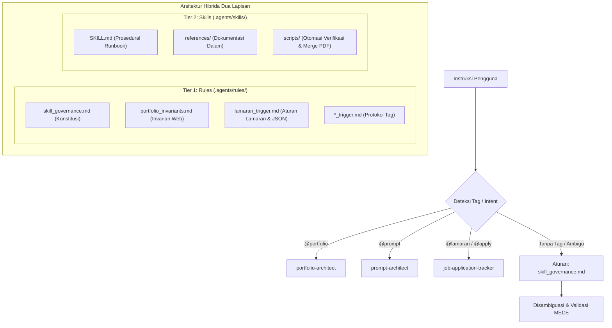

# Misbahudin - Developer Portfolio & Agent Architecture

> Portofolio rekayasa perangkat lunak profesional berstandar internasional yang dirancang dengan prinsip **ATS Machine-Readable**, **Cognitive 6-Second Scan HRD**, dan performa animasi **GSAP 60fps**, terintegrasi dengan sistem **Agentic AI Skills & Governance**.

[](.agents/rules/skill_governance.md)
[](llms.txt)
[](LICENSE)

---

## 📑 Daftar Isi
- [Ringkasan Proyek](#-ringkasan-proyek)
- [Persiapan Awal Sebelum Menggunakan Repo Ini](#-persiapan-awal-sebelum-menggunakan-repo-ini)
- [Arsitektur Keahlian Agen (Agent Skills System)](#-arsitektur-keahlian-agen-agent-skills-system)
  - [1. Matriks Keahlian Terdaftar (Registered Skills)](#1-matriks-keahlian-terdaftar-registered-skills)
  - [2. Rincian Kemampuan Setiap Skill](#2-rincian-kemampuan-setiap-skill)
  - [3. Tata Kelola & Protokol Anti-Kolisi (Skill Governance)](#3-tata-kelola--protokol-anti-kolisi-skill-governance)
  - [4. Panduan Praktis untuk Pengguna Awam (Cara Pakai Skill & Proses Melamar Kerja)](#4-panduan-praktis-untuk-pengguna-awam-cara-pakai-skill--proses-melamar-kerja)
  - [5. Panduan Menambahkan Skill Baru (MECE Checklist)](#5-panduan-menambahkan-skill-baru-mece-checklist)
- [Struktur Repositori](#-struktur-repositori)
- [Verifikasi & Pengujian Otomatis](#-verifikasi--pengujian-otomatis)
- [Panduan Deployment](#-panduan-deployment)

---

## 🚀 Ringkasan Proyek

Repositori ini bukan sekadar halaman web portofolio biasa, melainkan **pusat kendali karier lengkap** untuk [https://misbahudin98.github.io/](https://misbahudin98.github.io/). Di dalamnya sudah terpasang web portofolio modern, memori riwayat karier utama (SSoT), **dasbor pencatatan & pengiriman lamaran kerja (`tracker/index.html`)**, serta **3 keahlian AI (*Agent Skills*)** yang bisa langsung dipakai saat berinteraksi dengan asisten AI.

Dengan sistem ini, saat Anda mendapat info lowongan kerja baru, Anda tidak perlu lagi menulis CV, surat lamaran, pesan chat HRD, dan menggabung file PDF satu per satu dari nol — semuanya dapat dibuat, dirapikan, disimpan ke JSON, lalu dikirim langsung dari satu tempat.

* **Arsitektur Visual (SSoT):** **Warm Swiss Architectural Blueprint** (6 Babak Editorial: Profil, Karier, Pipeline Excel Interaktif, Galeri Proyek, Kompetensi & Pendidikan, Kontak Cepat HRD) pada [`design.md`](design.md).
* **Dasbor Tracker Lamaran:** [`tracker/index.html`](tracker/index.html) + [`tracker/api.php`](tracker/api.php) + [`tracker/applications.json`](tracker/applications.json) untuk mencatat riwayat lamaran, menyimpan pesan berbeda tiap platform (Email, WhatsApp, Glints, LinkedIn), serta tombol kirim 1-klik ke **WhatsApp**, **Outlook Web**, **Aplikasi Outlook Laptop**, dan **Gmail**.
* **Tech Stack Web:** Semantic HTML5, Tailwind CSS, GSAP 3.12.5 (ScrollTrigger), Chart.js 4.4.3, Schema.org JSON-LD, PHP 8 / JSON Storage.
* **Standar Aksesibilitas & Format:** WCAG 2.2 AA/AAA (Skip-to-Content, `:focus-visible`, Modal Focus Restoration, `tabular-nums`, `prefers-reduced-motion`), Dedicated `@media print` CSS (PDF Export).

---

## ⚙️ Persiapan Awal Sebelum Menggunakan Repo Ini

Sebelum mulai memakai repositori ini (terutama jika Anda baru menyalin / *clone* ke komputer lain atau ingin mengganti data pemiliknya), ada **6 komponen penting** yang perlu disiapkan lebih dulu. File yang bersifat rahasia/pribadi sudah otomatis dilindungi [`.gitignore`](.gitignore) agar tidak ikut terunggah ke GitHub publik:

| No | Yang Perlu Disiapkan | Lokasi File / Pengaturan | Penjelasan Singkat (Bahasa Sederhana) | Status Privasi Git |
| :--- | :--- | :--- | :--- | :--- |
| 1 | **Memori CV & Riwayat Karier Utama** | [`docs/cv_memory_ssot.md`](docs/cv_memory_ssot.md) | Isi biodata ringkas, riwayat kerja, daftar proyek, pendidikan, dan daftar keahlian Anda di sini. **Jangan masukkan NIK/Nomor KTP/data sensitif.** File ini menjadi "otak" rujukan AI setiap kali membuat CV, surat lamaran, dan pesan ke HRD. | Aman di-push (tanpa data sensitif) |
| 2 | **Halaman Portofolio, Foto/Aset & Link Resmi** | [`index.html`](index.html), [`assets/`](assets/), & [`.agents/rules/lamaran_trigger.md`](.agents/rules/lamaran_trigger.md) | Ganti nama, foto profil, screenshot proyek, email, serta nomor WhatsApp di `index.html`. Pastikan **tautan portofolio resmi** Anda (`https://...`) ditulis konsisten di `index.html`, `docs/cv_memory_ssot.md`, dan `.agents/rules/lamaran_trigger.md`. | Aman di-push |
| 3 | **File Gambar Tanda Tangan (TTD)** | `assets/ttd.png` & `assets/ttd_cropped.png` *(lokal)* | Siapkan gambar tanda tangan berlatar transparan (format PNG). `ttd_cropped.png` (versi yang sudah dipotong pas garis tanda tangan) dipakai otomatis oleh AI **hanya jika lowongan meminta Surat Lamaran resmi**. | **Dilindungi `.gitignore`** (tetap di laptop) |
| 4 | **Berkas Lampiran Pendukung & CV Umum** | [`assets/cv/berkas - tanpa sensitif.pdf`](./assets/cv/berkas%20-%20tanpa%20sensitif.pdf), [`assets/cv/CV_Misbahudin_Portofolio_Umum.pdf`](./assets/cv/CV_Misbahudin_Portofolio_Umum.pdf), [`cv.pdf`](cv.pdf) | Gabungkan ijazah, transkrip, atau sertifikat non-sensitif menjadi 1 PDF bernama `berkas - tanpa sensitif.pdf`. Saat AI membuat paket lamaran baru, berkas ini otomatis ditaruh di **halaman paling belakang** agar langsung siap kirim. | CV Umum di-push; PDF `Lamaran_*.pdf` **dilindungi `.gitignore`** |
| 5 | **Database Catatan Lamaran (JSON)** | `tracker/applications.json` *(lokal)* | Berisi riwayat lamaran, kisaran gaji, fasilitas, email HRD, dan nomor WhatsApp tujuan. Jika baru mulai di perangkat baru, buat file kosong berisi `{"applications": []}` atau langsung isi lewat [`tracker/index.html`](tracker/index.html) / perintah `@lamaran`. | **Dilindungi `.gitignore`** (data pribadi & HRD aman) |
| 6 | **Aplikasi Pendukung di Laptop** | **Laragon (PHP 8+)** & **Python 3 (`pypdf`)** | **Laragon/PHP** disarankan agar setiap edit di web tracker langsung tersimpan otomatis ke `applications.json` via [`tracker/api.php`](tracker/api.php) (tanpa Laragon pun web tracker tetap jalan lewat mode offline + Export/Import JSON). **Python + `pypdf`** diperlukan agar AI bisa menggabungkan PDF secara otomatis. | Berjalan lokal di komputer Anda |

> **Catatan Keamanan Publikasi:** File `assets/ttd.png`, `assets/ttd_cropped.png`, file PDF hasil rakitan (`assets/cv/Lamaran_*.pdf`, `assets/cv/Surat_Lamaran_*.pdf`), serta `tracker/applications.json` sengaja diblokir oleh `.gitignore` supaya tanda tangan dan data kontak rekruter tidak pernah bocor ke internet saat Anda melakukan `git push`.

---

## 🧠 Arsitektur Keahlian Agen (Agent Skills System)

Direktori [`.agents/`](.agents/) mengimplementasikan sistem kustomisasi agen otonom berdasarkan metodologi **Progressive Disclosure** dari Google DeepMind dan **Tool/Skill Routing** dari Anthropic (*Building Effective Agents*, Des 2024).

Dengan pemisahan ini, AI bekerja seperti tim spesialis yang masing-masing fokus pada tugasnya tanpa saling bertabrakan.

### 1. Matriks Keahlian Terdaftar (Registered Skills)

| Nama Skill | Direktori | Tag Pemicu | Kegunaan Sederhana (Untuk Pengguna) | Berkas Invarian Terkait |
| :--- | :--- | :--- | :--- | :--- |
| **`portfolio-architect`** | [`.agents/skills/portfolio-architect/`](.agents/skills/portfolio-architect/SKILL.md) | `@portfolio`, `@portfolio-architect`, `@portofolio` | Merapikan web portofolio, menulis profil/studi kasus dengan bahasa lugas ramah HRD, dan mengecek skor lolos sistem ATS. | [`.agents/rules/portfolio_invariants.md`](.agents/rules/portfolio_invariants.md) |
| **`prompt-architect`** | [`.agents/skills/prompt-architect/`](.agents/skills/prompt-architect/SKILL.md) | `@prompt`, `@pa`, `@prompt-architect` | Memperbaiki instruksi/perintah Anda ke AI agar jawabannya lebih akurat, tidak kaku seperti robot, dan menjaga aturan antar-skill tetap rapi. | [`.agents/rules/skill_governance.md`](.agents/rules/skill_governance.md) |
| **`job-application-tracker`** | [`.agents/skills/job-application-tracker/`](.agents/skills/job-application-tracker/SKILL.md) | `@lamaran`, `@apply` | Mengolah info lowongan kerja baru: mencatat detail (termasuk fasilitas, email & WA), membuat pesan humanis per platform, menyusun & menggabung berkas PDF (plus TTD otomatis jika butuh surat lamaran), dan menyimpannya ke JSON tracker. | [`.agents/rules/lamaran_trigger.md`](.agents/rules/lamaran_trigger.md) |

---

### 2. Rincian Kemampuan Setiap Skill

#### A. `portfolio-architect` ([Baca Dokumentasi Lengkap](.agents/skills/portfolio-architect/SKILL.md))
Keahlian khusus untuk menjaga integritas teknis dan dampak rekrutmen dari situs portofolio.
* **Audit 5 Dimensi Kualitas (Skor 0-100):**
  1. *ATS & Schema.org Grounding:* Pengujian parsing bot ATS, JSON-LD `@type: "Person"`, dan stylesheet `@media print`.
  2. *HRD 6-Second Cognitive Scan:* Audit lipatan layar pertama (*Above-the-Fold Quad*), Executive Summary 4 pilar, dan kartu proyek berbasis dampak.
  3. *GSAP 60fps Compositor-Only:* Proteksi performa animasi (`transform`/`opacity`) dan pematuhan `prefers-reduced-motion`.
  4. *Visual Hierarchy & Accessibility:* Tipografi scannable, rasio kontras warna WCAG AA, dan navigasi ramah pembaca layar.
  5. *Code Health & SSoT:* Ketiadaan layout thrashing dan sinkronisasi metadata SEO.
* **Standar Web3, Motion & Responsive Defensive:**
  - Panduan penanganan *"The Fatal Trinity"* berbasis heuristik Ethereum, Consensys, dan Google Core Web Vitals (LCP < 2.5s, INP < 200ms, CLS < 0.1) pada [`web3_motion_responsive_guide.md`](.agents/skills/portfolio-architect/references/web3_motion_responsive_guide.md).
* **Helper Tool:**
  ```powershell
  powershell -ExecutionPolicy Bypass -File ".agents/skills/portfolio-architect/scripts/audit-portfolio.ps1"
  ```

#### B. `prompt-architect` ([Baca Dokumentasi Lengkap](.agents/skills/prompt-architect/SKILL.md))
Keahlian khusus rekayasa prompt tingkat *enterprise* dan tata kelola sistem kecerdasan buatan.
* **Audit 6 Dimensi Kualitas Prompt (Skor 0-100):**
  1. *Role & Identity Calibration:* Batasan persona berstandar internasional.
  2. *Context Grounding & SSoT:* Dokumen sumber kebenaran tunggal dan batasan arsitektur.
  3. *Scope Granularity & Anti-Bulk:* Pencegahan *bulk sprawl* dan aturan *Single Feature Turn*.
  4. *Constraint Hardening & Anti-Slop:* Pembatasan larangan kode pemalas (`// TODO`), `NO_PLACEHOLDER`, dan 4 Visual State (Loading, Empty, Error, Success).
  5. *Output Schema & Determinism:* Isolasi blok XML terkunci dan kontrak RFC 7807.
  6. *Verification Gate:* Kriteria lolos uji terukur dan titik persetujuan manusia (*Human-in-the-Loop*).
* **Helper Tools:**
  ```powershell
  # Audit kualitas draf prompt
  powershell -ExecutionPolicy Bypass -File ".agents/skills/prompt-architect/scripts/audit-prompt.ps1" -PromptText "<DRAF_PROMPT>"

  # Kompilasi prompt terisolasi XML
  powershell -ExecutionPolicy Bypass -File ".agents/skills/prompt-architect/scripts/compile-prompt.ps1" -Role "Senior Engineer" -Task "Migrasi DB"
  ```

#### C. `job-application-tracker` ([Baca Dokumentasi Lengkap](.agents/skills/job-application-tracker/SKILL.md))
Keahlian khusus untuk mengolah lowongan kerja dari awal sampai berkas PDF siap kirim dan tercatat rapi di website tracker.
* **Ekstraksi Lengkap Info Lowongan:** Mencatat posisi, perusahaan, lokasi, kisaran gaji, **fasilitas/benefit yang didapat**, **alamat email tujuan**, **nomor WhatsApp** (baik HRD resmi maupun bagian informasi), syarat berkas, dan format nama file.
* **Pesan Humanis Berbeda per Platform:** Menyusun draf terpisah yang alami (tidak terasa seperti tulisan AI) untuk **Email** (subjek + isi), **WhatsApp** (bisa disesuaikan jika mengirim lewat kontak informasi agar tidak mengirim lampiran sembarangan bila tidak diminta), **Glints**, **LinkedIn**, dan **Sumber Lain**.
* **Perakitan 1 File PDF Otomatis (`merge-application-pdf.py`):**
  - Membuat **CV** yang ditonjolkan sesuai posisi lowongan.
  - Membuat **Surat Lamaran** hanya jika diminta lowongan, dengan **tanda tangan otomatis** [`assets/ttd_cropped.png`](assets/ttd_cropped.png) terpasang rapi di bagian tanda tangan.
  - Membuat **Portofolio PDF** jika diminta secara eksplisit.
  - Menggabungkan semua halaman di atas menjadi **1 file PDF** dengan [`assets/cv/berkas - tanpa sensitif.pdf`](./assets/cv/berkas%20-%20tanpa%20sensitif.pdf) selalu diletakkan di **urutan paling akhir**, lalu memberi nama file sesuai ketentuan HRD.
* **Pencatatan JSON & Dasbor Web Interaktif ([`tracker/index.html`](tracker/index.html)):**
  - Semua lamaran tersimpan dengan nomor ID berurutan (`APP-001`, `APP-002`, dst.) di [`tracker/applications.json`](tracker/applications.json).
  - Dilengkapi **API PHP lokal** ([`tracker/api.php`](tracker/api.php)), fitur **Tambah / Edit / Hapus Manual**, filter pencarian, ubah status langsung, **Export / Import JSON**, serta tombol kirim 1-klik ke **WhatsApp (`Kirim WA`)**, **Outlook Web**, **Aplikasi Outlook Laptop (`App Outlook`)**, dan **Gmail**.
* **Helper Tool:**
  ```powershell
  python ".agents/skills/job-application-tracker/scripts/merge-application-pdf.py" --output "assets/cv/Lamaran_NamaPosisi.pdf" --cover-letter "Surat_Lamaran.pdf" --cv "CV.pdf" --attachments "assets/cv/berkas - tanpa sensitif.pdf"
  ```

---

### 3. Tata Kelola & Protokol Anti-Kolisi (Skill Governance)

Untuk mencegah benturan fungsi antar-skill, repositori ini menerapkan aturan ketat pada [`.agents/rules/skill_governance.md`](.agents/rules/skill_governance.md) berbasis prinsip **MECE** (*Mutually Exclusive, Collectively Exhaustive*):



#### Prinsip Inti Tata Kelola:
1. **Aturan (Rules) vs. Keahlian (Skills):**
   * **Rules (`.agents/rules/`):** Menyimpan batasan mutlak (*Invariants*), larangan (*Negative Constraints*), dan protokol pemicu. Bersifat *Always-On* dan dibatasi kuota 24 KB / 20.000 token.
   * **Skills (`.agents/skills/`):** Menyimpan prosedur eksekusi, rubrik, dan skrip helper. Bersifat *Lazy-Loaded* (hanya dimuat saat dibutuhkan).
2. **Ortogonalitas Mutlak:** Setiap skill punya tugas sendiri — Skill Portofolio mengurus web & profil HRD, Skill Prompt mengurus instruksi AI, dan Skill Lamaran mengurus tracker JSON, pesan lamaran, serta gabungan PDF.
3. **Progressive Disclosure:** Deskripsi pada metadata frontmatter wajib ringkas (< 50 kata) agar tidak memboroskan token saat pengindeksan awal agen.

---

### 4. Panduan Praktis untuk Pengguna Awam (Cara Pakai Skill & Proses Melamar Kerja)

Anda **tidak perlu paham coding** untuk memaksimalkan seluruh fitur repositori ini. Cukup panggil AI menggunakan **kata kunci berawalan `@`** di awal pesan Anda. Bahkan, Anda boleh menggabungkan dua atau tiga tag sekaligus (misal: `@prompt @portfolio @lamaran`).

#### A. Ringkasan Cepat Kapan Harus Memakai Tag Apa

| Kondisi / Kebutuhan Anda | Tag yang Dipakai | Contoh Kalimat Sederhana ke AI |
| :--- | :--- | :--- |
| Mau merapikan tampilan web portofolio, bahasa profil HRD, atau menambah proyek baru | `@portfolio` | `@portfolio cek tampilan web saya apakah ramah HRD dan ubah bahasanya biar tidak kaku seperti AI` |
| Mau merapikan perintah ke AI supaya jawabannya tepat & tidak bertele-tele | `@prompt` | `@prompt rapikan instruksi ini supaya hasilnya lebih terstruktur: "..."` |
| **Baru dapat info lowongan kerja** & mau dibuatkan CV, pesan kirim, PDF gabung, lalu disimpan ke daftar lamaran | `@lamaran` | `@lamaran ini ada lowongan Staff IT di PT Maju Jaya, tolong buatkan berkas, pesan WA/Email, dan simpan ke JSON` |
| Mau menggabungkan semuanya sekaligus (bahasa natural + sesuai profil + tracker JSON) | `@prompt @portfolio @lamaran` | `@prompt @portfolio @lamaran saya dapat info loker ini [tempel info/poster loker], tolong siapkan semua kebutuhannya` |

---

#### B. Alur Lengkap Saat Mendapatkan Lowongan Kerja (4 Langkah Praktis)

Berikut urutan paling mudah dari saat Anda menemukan info lowongan hingga lamaran terkirim dan tercatat rapi:

##### Langkah 1 — Kirim Info Lowongan ke AI
Tempel (*copy-paste*) teks lowongan, tangkapan layar poster loker, atau tautan informasinya ke chat AI, lalu awali dengan `@lamaran` (bisa ditambah `@prompt @portfolio`).

AI otomatis akan membaca dan merangkum:
- Nama perusahaan, posisi yang dilamar, lokasi, dan jenis kerja (WFO/Hybrid/Remote).
- **Kisaran gaji** dan **fasilitas/benefit** (BPJS, THR, makan, bonus, jenjang karier, dll.).
- **Alamat Email tujuan** dan **Nomor WhatsApp tujuan** (beserta keterangan apakah itu email HRD resmi atau nomor bagian informasi).
- Syarat berkas yang diminta (apakah perlu CV saja, atau wajib **Surat Lamaran** dan **Portofolio**) serta aturan penamaan file PDF.

##### Langkah 2 — AI Membuatkan Pesan Humanis Tiap Platform & Menyimpan ke JSON
AI otomatis menulis pesan yang bahasanya luwes dan manusiawi (berbeda antara satu platform dengan platform lain agar tidak terlihat *copy-paste* robot):
- **Email:** Lengkap dengan *Subject* dan *Body* yang sopan dan profesional.
- **WhatsApp:** Bahasa ringkas dan sopan. Jika yang tersedia hanya kontak bagian informasi (sementara lamaran resmi lewat email), AI menyesuaikan pesannya untuk menanyakan/konfirmasi pengiriman berkas tanpa memaksa mengirim file di WA.
- **Glints / LinkedIn / Sumber Lain:** Draf catatan lamaran singkat yang relevan dengan platform masing-masing.

Semua data tadi langsung dicatat oleh AI ke file [`tracker/applications.json`](tracker/applications.json) dengan ID unik otomatis (misalnya **`APP-001`**, **`APP-002`**, dst.).
> **Tips Praktis:** Kapan saja Anda lupa isi pesan untuk lamaran tertentu, cukup tulis ke AI:  
> `@lamaran tampilkan format pesan dan detail untuk APP-001`

##### Langkah 3 — AI Membuat CV, Surat Lamaran (Bertanda Tangan), & Menggabung 1 PDF
Sesuai data resmi Anda di [`docs/cv_memory_ssot.md`](docs/cv_memory_ssot.md):
1. AI menyusun **CV** khusus yang menonjolkan pengalaman Anda yang paling cocok dengan syarat lowongan tersebut.
2. **Khusus jika lowongan meminta Surat Lamaran**, AI membuatkan Surat Lamaran dan otomatis menempelkan gambar tanda tangan Anda ([`assets/ttd_cropped.png`](assets/ttd_cropped.png)) di kolom tanda tangan.
3. Jika diminta Portofolio, dokumen Portofolio juga disiapkan dengan link resmi `https://misbahudin98.github.io/`.
4. Terakhir, AI menggabungkan semuanya menjadi **1 file PDF utuh** dengan berkas lampiran pendukung Anda ([`assets/cv/berkas - tanpa sensitif.pdf`](./assets/cv/berkas%20-%20tanpa%20sensitif.pdf)) berada di **halaman paling belakang**, serta memberi nama file PDF sesuai permintaan HRD.

##### Langkah 4 — Kelola Riwayat & Kirim 1-Klik via Website Tracker (`tracker/index.html`)
Semua hasil rekapan di atas bisa langsung Anda lihat, ubah, dan kirim melalui halaman dasbor tracker:

1. **Cara Membuka Tracker (Pilih Salah Satu):**
   - **Mode Laragon / Server Lokal (Disarankan):** Jalankan Laragon, lalu buka `http://localhost/misbahudin-portfolio/tracker/` di browser. Pada mode ini, setiap Anda **Tambah**, **Edit**, **Hapus**, atau **Ubah Status** lamaran di website, datanya otomatis tersimpan permanen ke file [`tracker/applications.json`](tracker/applications.json) lewat [`tracker/api.php`](tracker/api.php).
   - **Mode Buka File Langsung (Offline):** Klik dua kali file [`tracker/index.html`](tracker/index.html). Perubahan tersimpan di browser (`localStorage`), dan Anda tetap bisa memindahkan data memakai tombol **Export JSON** / **Import JSON**.
2. **Fitur di Dalam Website Tracker:**
   - **Kartu Ringkasan (KPI):** Melihat total lamaran, berapa yang masih disiapkan, sudah dikirim, tahap interview, hingga diterima.
   - **Cari, Filter & Input Manual:** Tambah lowongan secara manual tanpa AI, edit gaji/fasilitas/kontak, ubah status langsung dari tabel, atau hapus data lama.
   - **Lihat & Salin Pesan Tiap Platform:** Klik tombol **"Pesan"** pada baris lamaran untuk membaca sekaligus menyalin draf Email, WhatsApp, Glints, LinkedIn, atau lainnya.
   - **Tombol Kirim Langsung 1-Klik (Tidak Perlu Ketik Ulang):**
     - **`Kirim WA`:** Otomatis membuka WhatsApp menuju nomor tujuan dengan teks pesan sudah terisi siap tekan Kirim.
     - **`Outlook Web`:** Membuka Microsoft Outlook versi web dengan email tujuan, subjek, dan isi pesan sudah terisi otomatis.
     - **`App Outlook`:** Membuka aplikasi email bawaan / Microsoft Outlook di laptop Anda (`mailto:`) dengan draf siap kirim (tinggal lampirkan file PDF gabungan).
     - **`Gmail`:** Membuka Gmail Web dengan tujuan, subjek, dan isi pesan sudah terisi otomatis.

---

#### C. Contoh Perintah Siap Pakai (Tinggal Copy-Paste ke AI)

* **Saat baru dapat lowongan kerja (paling sering dipakai):**
  ```text
  @prompt @portfolio @lamaran saya dapat info lowongan ini:
  [Tempel teks / kirim gambar lowongan kerja di sini]
  Tolong rekap detail, gaji, fasilitas, email, dan nomor WA ke JSON, buatkan pesan humanis per platform, serta racik CV + berkas PDF gabungannya.
  ```
* **Saat ingin mengirim ulang atau melihat catatan lamaran berdasarkan ID:**
  ```text
  @lamaran tampilkan detail dan format pesan WhatsApp & Email untuk ID APP-001
  ```
* **Saat ingin mengupdate status lamaran (misal dapat panggilan interview):**
  ```text
  @lamaran ubah status APP-001 menjadi Interview dan catat jadwal interview hari Kamis jam 10.00
  ```
* **Saat ingin memperbaiki halaman web portofolio atau menambah proyek baru:**
  ```text
  @portfolio tambahkan proyek baru [nama proyek] ke halaman web dengan bahasa yang mudah dipahami HRD dan pastikan skor audit tetap 100/100
  ```
* **Saat ingin merapikan atau mengecek kualitas prompt AI:**
  ```text
  @prompt audit dan perbaiki prompt ini supaya hasilnya tidak terkesan seperti AI:
  "Buatkan surat lamaran kerja untuk posisi Admin"
  ```

---

### 5. Panduan Menambahkan Skill Baru (MECE Checklist)

Jika Anda ingin menambahkan keahlian baru (misalnya: `seo-architect` atau `security-architect`), ikuti protokol berikut:
1. Buat folder baru di `.agents/skills/<nama-skill>/`.
2. Sediakan berkas wajib `SKILL.md` dengan YAML frontmatter ringkas (< 50 kata).
3. Daftarkan tag pemicu unik berawalan `@` yang belum pernah dipakai.
4. Buat subfolder `references/`, `examples/`, dan `scripts/`.
5. Daftarkan invarian di matriks [`.agents/rules/skill_governance.md`](.agents/rules/skill_governance.md).
6. Jalankan skrip verifikasi otomatis untuk memastikan skor kelayakan minimal 90/100:
   ```powershell
   powershell -ExecutionPolicy Bypass -File ".agents/skills/prompt-architect/scripts/audit-skills.ps1"
   ```

---

## 📁 Struktur Repositori

```text
misbahudin-portfolio/
├── .agents/
│   ├── rules/                               # Invarian & Konstitusi Agen (Always-On)
│   │   ├── lamaran_trigger.md               # Protokol reaktif @lamaran/@apply, TTD & JSON
│   │   ├── portfolio_invariants.md          # Invarian ATS, GSAP 60fps, Bahasa Lugas & WCAG 2.2 AA
│   │   ├── portfolio_trigger.md             # Protokol reaktif @portfolio
│   │   ├── prompt_architect_trigger.md      # Protokol reaktif @prompt
│   │   └── skill_governance.md              # Konstitusi MECE & Anti-Overlap Skill
│   └── skills/                              # Runbook & Prosedur Keahlian (On-Demand)
│       ├── job-application-tracker/         # Keahlian Olah Lowongan, Pesan Humanis & Merge PDF
│       │   ├── SKILL.md
│       │   ├── references/application_schema_and_tones.md
│       │   └── scripts/merge-application-pdf.py
│       ├── portfolio-architect/             # Keahlian Desain & Kualitas Portofolio
│       │   ├── SKILL.md
│       │   ├── examples/
│       │   ├── references/
│       │   └── scripts/audit-portfolio.ps1
│       └── prompt-architect/                # Keahlian Rekayasa Prompt & Tata Kelola
│           ├── SKILL.md
│           ├── examples/
│           ├── references/skill_governance_rubric.md
│           ├── scripts/audit-skills.ps1
│           └── scripts/audit-prompt.ps1
├── assets/                                  # Aset Gambar, Foto, TTD & Dokumen CV
│   ├── ttd_cropped.png                      # Tanda tangan transparan otomatis untuk Surat Lamaran
│   └── cv/                                  # Hasil CV, Surat Lamaran, & berkas - tanpa sensitif.pdf
├── tracker/                                 # Website Dasbor Pencatatan & Pengiriman Lamaran Kerja
│   ├── index.html                           # Halaman Interaktif CRUD, Filter, Modal & 1-Klik Kirim WA/Email
│   ├── api.php                              # Backend PHP penyimpan otomatis ke applications.json
│   └── applications.json                    # Database JSON seluruh riwayat lamaran (APP-001, dst.)
├── design.md                                # SSoT Sistem Desain Warm Swiss Editorial & Motion
├── docs/                                    # Arsitektur ETL & Memori Master CV Lokal (SSoT)
│   ├── cv_memory_ssot.md                    # Memori CV Terkontrol Versi (Tanpa Data Sensitif)
│   └── etl_data_engineering_vs_data_analysis.md
├── index.html                               # Berkas Utama Web Portofolio 6 Babak & GSAP Engine
├── llms.txt                                 # AI & LLM Context Specification (llmstxt.org)
├── netlify.toml                             # Konfigurasi Build & Header Keamanan Netlify
├── deploy_netlify.py                        # Skrip Otomasi Deployment Netlify
└── README.md                                # Dokumentasi Proyek & Panduan Pengguna Awam
```

---

## 🧪 Verifikasi & Pengujian Otomatis

Jalankan pengujian kesehatan repositori langsung dari terminal:

```powershell
# 1. Audit Tata Kelola Seluruh Skill (MECE & Anti-Collision Check)
powershell -ExecutionPolicy Bypass -File ".agents/skills/prompt-architect/scripts/audit-skills.ps1"

# 2. Audit Kualitas Halaman Portofolio (ATS, GSAP, & DOM Check)
powershell -ExecutionPolicy Bypass -File ".agents/skills/portfolio-architect/scripts/audit-portfolio.ps1"
```

---

## 🌐 Panduan Deployment

Situs ini dikonfigurasi untuk rilis instan di platform **Netlify**:

```bash
# Menggunakan Netlify CLI
netlify deploy --prod --dir=.

# Atau menjalankan skrip otomasi Python lokal
python deploy_netlify.py
```

Header keamanan seperti `Content-Security-Policy`, `X-Frame-Options`, dan `X-Content-Type-Options` dikonfigurasi secara deklaratif di [`netlify.toml`](netlify.toml) dan [`_headers`](_headers).

---

**Misbahudin**  
*Full Stack Developer & Data Systems Engineer*  
GitHub: [@misbahudin98](https://github.com/misbahudin98) • LinkedIn: [misbahudin98](https://www.linkedin.com/in/misbahudin98/)
