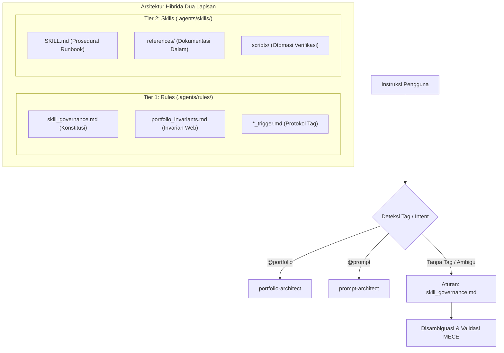

# Misbahudin - Developer Portfolio & Agent Architecture

> Portofolio rekayasa perangkat lunak profesional berstandar internasional yang dirancang dengan prinsip **ATS Machine-Readable**, **Cognitive 6-Second Scan HRD**, dan performa animasi **GSAP 60fps**, terintegrasi dengan sistem **Agentic AI Skills & Governance**.

[](.agents/rules/skill_governance.md)
[](llms.txt)
[](LICENSE)

---

## 📑 Daftar Isi
- [Ringkasan Proyek](#-ringkasan-proyek)
- [Arsitektur Keahlian Agen (Agent Skills System)](#-arsitektur-keahlian-agen-agent-skills-system)
  - [1. Matriks Keahlian Terdaftar (Registered Skills)](#1-matriks-keahlian-terdaftar-registered-skills)
  - [2. Rincian Kemampuan Setiap Skill](#2-rincian-kemampuan-setiap-skill)
  - [3. Tata Kelola & Protokol Anti-Kolisi (Skill Governance)](#3-tata-kelola--protokol-anti-kolisi-skill-governance)
  - [4. Cara Menggunakan & Memicu Skill](#4-cara-menggunakan--memicu-skill)
  - [5. Panduan Menambahkan Skill Baru (MECE Checklist)](#5-panduan-menambahkan-skill-baru-mece-checklist)
- [Struktur Repositori](#-struktur-repositori)
- [Verifikasi & Pengujian Otomatis](#-verifikasi--pengujian-otomatis)
- [Panduan Deployment](#-panduan-deployment)

---

## 🚀 Ringkasan Proyek

Repositori ini berisi kode sumber web portofolio [misbahudin98.netlify.app](https://misbahudin98.netlify.app) serta konfigurasi kecerdasan buatan pair-programming agen (Antigravity CLI / AI Coding Agent) yang mengotomatiskan audit, penulisan studi kasus berbasis dampak (STAR Formula), dan rekayasa prompt tingkat korporat.

* **Tech Stack Web:** Semantic HTML5, Tailwind CSS, GSAP 3.12 (ScrollTrigger), Schema.org JSON-LD, Lucide Icons.
* **Standar Aksesibilitas & Format:** WCAG 2.2 AA, Dedicated `@media print` CSS (PDF Export), Anti-FOUC Theme Switcher.

---

## 🧠 Arsitektur Keahlian Agen (Agent Skills System)

Direktori [`.agents/`](.agents/) mengimplementasikan sistem kustomisasi agen otonom berdasarkan metodologi **Progressive Disclosure** dari Google DeepMind dan **Tool/Skill Routing** dari Anthropic (*Building Effective Agents*, Des 2024).

Dengan pemisahan ini, agen tidak membebani jendela konteks (*context window*) secara berlebihan, dan setiap keahlian memiliki batas fungsional (*boundary*) yang kedap udara.

### 1. Matriks Keahlian Terdaftar (Registered Skills)

| Nama Skill | Direktori | Tag Pemicu | Domain Utama | Berkas Invarian Terkait |
| :--- | :--- | :--- | :--- | :--- |
| **`portfolio-architect`** | [`.agents/skills/portfolio-architect/`](.agents/skills/portfolio-architect/SKILL.md) | `@portfolio`, `@portfolio-architect` | Audit web portofolio, arsitektur DOM/ATS, resep animasi GSAP, & template studi kasus STAR. | [`.agents/rules/portfolio_invariants.md`](.agents/rules/portfolio_invariants.md) |
| **`prompt-architect`** | [`.agents/skills/prompt-architect/`](.agents/skills/prompt-architect/SKILL.md) | `@prompt`, `@pa`, `@prompt-architect` | Rekayasa prompt AI standar internasional (XML-Delimited Anthropic/OpenAI), audit prompt, & governance agen. | [`.agents/rules/skill_governance.md`](.agents/rules/skill_governance.md) |

---

### 2. Rincian Kemampuan Setiap Skill

#### A. `portfolio-architect` ([Baca Dokumentasi Lengkap](.agents/skills/portfolio-architect/SKILL.md))
Keahlian khusus untuk menjaga integritas teknis dan dampak rekrutmen dari situs portofolio.
* **Audit 5 Dimensi Kualitas (Skor 0-100):**
  1. *ATS & Schema.org Grounding:* Pengujian parsing bot ATS, JSON-LD `@type: "Person"`, dan stylesheet `@media print`.
  2. *HRD 6-Second Cognitive Scan:* Audit lipatan layar pertama (*Above-the-Fold Quad*), Executive Summary 4 pilar, dan kartu proyek berbasis dampak.
  3. *GSAP 60fps Compositor-Only:* Proteksi performa animasi (`transform`/`opacity`) dan pematuhan `prefers-reduced-motion`.
  4. *Visual Hierarchy & Accessibility:* Tipografi scannable, rasio kontras warna WCAG AA, dan navigasi ramah pembaca layar.
  5. *Code Health & SSoT:* Ketiadaan layout thrashing dan sinkronisasi metadata SEO.
* **Standar Web3, Motion & Responsive Defensive:**
  - Panduan penanganan *"The Fatal Trinity"* berbasis heuristik Ethereum, Consensys, dan Google Core Web Vitals (LCP < 2.5s, INP < 200ms, CLS < 0.1) pada [`web3_motion_responsive_guide.md`](.agents/skills/portfolio-architect/references/web3_motion_responsive_guide.md).
* **Helper Tool:**
  ```powershell
  powershell -ExecutionPolicy Bypass -File ".agents/skills/portfolio-architect/scripts/audit-portfolio.ps1"
  ```

#### B. `prompt-architect` ([Baca Dokumentasi Lengkap](.agents/skills/prompt-architect/SKILL.md))
Keahlian khusus rekayasa prompt tingkat *enterprise* dan tata kelola sistem kecerdasan buatan.
* **Audit 6 Dimensi Kualitas Prompt (Skor 0-100):**
  1. *Role & Identity Calibration:* Batasan persona berstandar internasional.
  2. *Context Grounding & SSoT:* Dokumen sumber kebenaran tunggal dan batasan arsitektur.
  3. *Scope Granularity & Anti-Bulk:* Pencegahan *bulk sprawl* dan aturan *Single Feature Turn*.
  4. *Constraint Hardening & Anti-Slop:* Pembatasan larangan kode pemalas (`// TODO`), `NO_PLACEHOLDER`, dan 4 Visual State (Loading, Empty, Error, Success).
  5. *Output Schema & Determinism:* Isolasi blok XML terkunci dan kontrak RFC 7807.
  6. *Verification Gate:* Kriteria lolos uji terukur dan titik persetujuan manusia (*Human-in-the-Loop*).
* **Helper Tools:**
  ```powershell
  # Audit kualitas draf prompt
  powershell -ExecutionPolicy Bypass -File ".agents/skills/prompt-architect/scripts/audit-prompt.ps1" -PromptText "<DRAF_PROMPT>"

  # Kompilasi prompt terisolasi XML
  powershell -ExecutionPolicy Bypass -File ".agents/skills/prompt-architect/scripts/compile-prompt.ps1" -Role "Senior Engineer" -Task "Migrasi DB"
  ```

---

### 3. Tata Kelola & Protokol Anti-Kolisi (Skill Governance)

Untuk mencegah benturan semantik (*ambiguous affordances*), repositori ini menerapkan aturan ketat pada [`.agents/rules/skill_governance.md`](.agents/rules/skill_governance.md) berbasis prinsip **MECE** (*Mutually Exclusive, Collectively Exhaustive*):



#### Prinsip Inti Tata Kelola:
1. **Aturan (Rules) vs. Keahlian (Skills):**
   * **Rules (`.agents/rules/`):** Menyimpan batasan mutlak (*Invariants*), larangan (*Negative Constraints*), dan protokol pemicu. Bersifat *Always-On* dan dibatasi kuota 24 KB / 20.000 token.
   * **Skills (`.agents/skills/`):** Menyimpan prosedur eksekusi, rubrik, dan skrip helper. Bersifat *Lazy-Loaded* (hanya dimuat saat dibutuhkan).
2. **Ortogonalitas Mutlak:** Skill Portofolio dilarang menyusun prompt AI umum, dan Skill Prompt dilarang mengatur styling antarmuka web.
3. **Progressive Disclosure:** Deskripsi pada metadata frontmatter wajib ringkas (< 50 kata) agar tidak memboroskan token saat pengindeksan awal agen.

---

### 4. Cara Menggunakan & Memicu Skill

Sertakan tag pemicu eksplisit di awal prompt saat berinteraksi dengan agen AI:

* **Untuk Meninjau & Mengaudit Portofolio:**
  ```text
  @portfolio audit performa halaman dan cek skor ATS
  ```
* **Untuk Menambahkan Proyek Baru ke Portofolio:**
  ```text
  @portfolio buatkan studi kasus baru untuk proyek sistem migrasi data 12.000 row dengan formula STAR
  ```
* **Untuk Mengaudit atau Mengoptimalkan Prompt AI:**
  ```text
  @prompt tolong audit prompt berikut dan naikkan skornya ke Tier 1:
  "Buatkan controller auth di Laravel"
  ```
* **Untuk Mengaudit Tata Kelola Semua Skill di Repositori:**
  ```text
  @prompt periksa kepatuhan seluruh skill dan pastikan tidak ada benturan tag
  ```

---

### 5. Panduan Menambahkan Skill Baru (MECE Checklist)

Jika Anda ingin menambahkan keahlian baru (misalnya: `seo-architect` atau `security-architect`), ikuti protokol berikut:
1. Buat folder baru di `.agents/skills/<nama-skill>/`.
2. Sediakan berkas wajib `SKILL.md` dengan YAML frontmatter ringkas (< 50 kata).
3. Daftarkan tag pemicu unik berawalan `@` yang belum pernah dipakai.
4. Buat subfolder `references/`, `examples/`, dan `scripts/`.
5. Daftarkan invarian di matriks [`.agents/rules/skill_governance.md`](.agents/rules/skill_governance.md).
6. Jalankan skrip verifikasi otomatis untuk memastikan skor kelayakan minimal 90/100:
   ```powershell
   powershell -ExecutionPolicy Bypass -File ".agents/skills/prompt-architect/scripts/audit-skills.ps1"
   ```

---

## 📁 Struktur Repositori

```text
misbahudin-portfolio/
├── .agents/
│   ├── rules/                               # Invarian & Konstitusi Agen (Always-On)
│   │   ├── portfolio_invariants.md          # Invarian ATS, GSAP 60fps, & WCAG 2.2 AA
│   │   ├── portfolio_trigger.md             # Protokol reaktif @portfolio
│   │   ├── prompt_architect_trigger.md      # Protokol reaktif @prompt
│   │   └── skill_governance.md              # Konstitusi MECE & Anti-Overlap Skill
│   └── skills/                              # Runbook & Prosedur Keahlian (On-Demand)
│       ├── portfolio-architect/             # Keahlian Desain & Kualitas Portofolio
│       │   ├── SKILL.md
│       │   ├── examples/
│       │   ├── references/
│       │   └── scripts/audit-portfolio.ps1
│       └── prompt-architect/                # Keahlian Rekayasa Prompt & Tata Kelola
│           ├── SKILL.md
│           ├── examples/
│           ├── references/skill_governance_rubric.md
│           ├── scripts/audit-skills.ps1
│           └── scripts/audit-prompt.ps1
├── assets/                                  # Tangible Screenshot Artifacts (PPDB, SDM, Santri, Farm)
├── index.html                               # Berkas Utama Web Portofolio & Parallax Engine
├── llms.txt                                 # AI & LLM Context Specification (llmstxt.org)
├── netlify.toml                             # Konfigurasi Build & Header Keamanan Netlify
├── deploy_netlify.py                        # Skrip Otomasi Deployment Netlify
└── README.md                                # Dokumentasi Proyek & Arsitektur
```

---

## 🧪 Verifikasi & Pengujian Otomatis

Jalankan pengujian kesehatan repositori langsung dari terminal:

```powershell
# 1. Audit Tata Kelola Seluruh Skill (MECE & Anti-Collision Check)
powershell -ExecutionPolicy Bypass -File ".agents/skills/prompt-architect/scripts/audit-skills.ps1"

# 2. Audit Kualitas Halaman Portofolio (ATS, GSAP, & DOM Check)
powershell -ExecutionPolicy Bypass -File ".agents/skills/portfolio-architect/scripts/audit-portfolio.ps1"
```

---

## 🌐 Panduan Deployment

Situs ini dikonfigurasi untuk rilis instan di platform **Netlify**:

```bash
# Menggunakan Netlify CLI
netlify deploy --prod --dir=.

# Atau menjalankan skrip otomasi Python lokal
python deploy_netlify.py
```

Header keamanan seperti `Content-Security-Policy`, `X-Frame-Options`, dan `X-Content-Type-Options` dikonfigurasi secara deklaratif di [`netlify.toml`](netlify.toml) dan [`_headers`](_headers).

---

**Misbahudin**  
*Full Stack Developer & Data Systems Engineer*  
GitHub: [@misbahudin98](https://github.com/misbahudin98) • LinkedIn: [misbahudin98](https://www.linkedin.com/in/misbahudin98/)
