# Arsitektur ETL: Perspektif Data Engineering vs Data Analysis
> **Standar Dokumen:** ISO 24495-1 (Plain Language), Diátaxis Framework, Kimball Dimensional Modeling, dan Enterprise Data Architecture.  
> **Status:** Single Source of Truth (SSoT) untuk Pemahaman Pipeline & Semantik Data.

---

## 1. PREAMBULE & MENTAL MODEL

Proses **ETL (*Extract, Transform, Load*)** adalah fondasi sirkulasi informasi di organisasi modern. Namun, istilah ini sering memicu kerancuan karena memiliki arti, tujuan, dan metrik keberhasilan yang berbeda bagi dua peran sentral: **Data Engineer (DE)** dan **Data Analyst (DA)**.

### Analogi Sistem Pengolahan Air Kota
* **Data Engineer = Insinyur Perpipaan & Pengolahan Air Industri (*Water Treatment Plant*):**  
  Tugasnya memastikan air disedot dari berbagai sumber (sungai, danau, air tanah) tanpa pipa pecah, menyaring endapan lumpur kasar, memastikan debit air stabil 24/7, dan mendistribusikannya melalui pipa bertekanan tinggi ke tandon utama tanpa ada tetesan yang hilang (*zero data loss*).
* **Data Analyst = Ahli Kualitas Air & Ahli Nutrisi Minuman:**  
  Tugasnya mengambil air bersih dari tandon, menguji kandungan mineralnya, meraciknya menjadi air siap minum dengan formulasi yang tepat (misal: air alkali untuk atlet atau air steril untuk laboratorium), lalu menyajikannya ke konsumen akhir (eksekutif/manajemen) agar aman dan langsung memberi manfaat bisnis.

> *"Data Engineer membangun jalannya, Data Analyst mengemudikan kendaraannya."*

---

## 2. DIAGRAM ARSITEKTUR ALUR ETL (END-TO-END)

```mermaid
flowchart LR
    subgraph SOURCES ["Sumber Data Mentah"]
        S1["RDBMS (Postgres/MySQL)"]
        S2["CDC Event Streams (Kafka)"]
        S3["REST API & Log Server"]
    end

    subgraph DE_DOMAIN ["Domain Data Engineering (Infrastruktur & Skala)"]
        direction TB
        E_DE["1. EXTRACT (Ingestion)<br/>Chunking 500 rows, CDC, Zero-Lock"]
        T_DE["2. TRANSFORM (Technical)<br/>Deduplikasi, 3NF, Sanitasi CWE-1236"]
        L_DE["3. LOAD (Warehouse Storage)<br/>Atomic DB::transaction, SHA-256 Checksum"]
        E_DE --> T_DE --> L_DE
    end

    subgraph DA_DOMAIN ["Domain Data Analyst (Semantik & Aksi Bisnis)"]
        direction TB
        E_DA["1. EXTRACT (Discovery)<br/>Audit SSoT, Eliminasi Ambiguitas"]
        T_DA["2. TRANSFORM (Semantic Modeling)<br/>Star Schema, KPI Metrics (MoM/YoY), dbt"]
        L_DA["3. LOAD (BI Delivery)<br/>Agregasi Data Mart, Dasbor Eksekutif &le;2s"]
        E_DA --> T_DA --> L_DA
    end

    SOURCES --> E_DE
    L_DE -.->|"Data Warehouse Bersih"| E_DA
    L_DA --> BIZ["Stakeholder Bisnis (C-Level / Manajer Operasional)"]
```

---

## 3. DEKONSTRUKSI TAHAPAN: DATA ENGINEER VS DATA ANALYST

### A. Tahap 1: EXTRACT (Ekstraksi)
* **Kacamata Data Engineer:**
  - **Fokus:** Bagaimana menarik volume data besar secara efisien tanpa membebani database operasional (*production database lock*).
  - **Teknik:**
    1. *Memory-Safe Chunk Streaming:* Menggunakan pembacaan kursor kueri berbasis chunk (misal: 500 entri per iterasi) untuk menjaga konsumsi RAM stabil $\le 32\text{MB}$.
    2. *Change Data Capture (CDC):* Menangkap mutasi data melalui database binlog tanpa kueri polling berulang.
    3. *Defensive Ingestion:* Menangani rate limits, token refresh, retry dengan exponential backoff, dan schema drift (penambahan kolom tak terduga).
* **Kacamata Data Analyst:**
  - **Fokus:** Di mana sumber kebenaran data (*Single Source of Truth*) dan apakah data tersebut valid secara operasional.
  - **Teknik:**
    1. *Data Discovery & Audit:* Menginvestigasi perbedaan angka antar-departemen (misal: Humas mencatat 9.312 santri, tetapi Keuangan mencatat 9.150 santri karena perbedaan definisi status santri aktif).
    2. *Kamus Data (*Data Dictionary*):* Mendefinisikan arti setiap kolom sebelum digunakan dalam perhitungan.

---

### B. Tahap 2: TRANSFORM (Transformasi)
* **Kacamata Data Engineer (Transformasi Struktural & Komputasi):**
  - **Fokus:** Integritas relasional, kecepatan komputasi, dan pencegahan error tingkat sistem.
  - **Teknik:**
    1. *Normalisasi Basis Data (3NF):* Memecah struktur spreadsheet datar menjadi tabel relasional ternormalisasi untuk mengeliminasi redundansi data.
    2. *Sanitasi Keamanan:* Proteksi terhadap formula injection CWE-1236 (menetralisir sel yang diawali `=`, `+`, `-`, atau `@`) dan sanitasi encoding UTF-8 BOM.
    3. *Idempotency:* Menjamin bahwa pipeline jika dijalankan ulang untuk batch yang sama tidak akan menghasilkan baris ganda (*deterministic execution*).
* **Kacamata Data Analyst (Transformasi Bisnis & Pemodelan Semantik):**
  - **Fokus:** Merumuskan logika bisnis menjadi metrik kuantitatif yang dapat ditindaklanjuti.
  - **Teknik:**
    1. *Dimensional Modeling (Star Schema):* Membangun tabel dimensi (`dim_santri`, `dim_waktu`, `dim_lembaga`) dan tabel fakta (`fact_pembayaran_spp`, `fact_registrasi_ppdb`).
    2. *Perumusan KPI:* Menulis kueri analitik dengan window functions (`OVER (PARTITION BY ...)`), perhitungan Month-over-Month (MoM), Year-over-Year (YoY), dan cohort retention rate.
    3. *Data Cleansing Logika Bisnis:* Menghapus data transaksi uji coba (*test transactions*), menangani diskon promo khusus, dan memisahkan pembatalan tagihan.

---

### C. Tahap 3: LOAD (Pemuatan)
* **Kacamata Data Engineer:**
  - **Fokus:** Menulis data secara masif ke penyimpanan permanen dengan garansi ACID (*Atomicity, Consistency, Isolation, Durability*).
  - **Teknik:**
    1. *Atomic Transaction:* Seluruh mutasi batch dibungkus dalam `DB::transaction()` sehingga jika terjadi anomali pada record ke-501, sistem otomatis me-rollback seluruh operasi tanpa menyisakan data yatim (*orphan data*).
    2. *Slowly Changing Dimensions (SCD):* Menangani riwayat perubahan entitas (SCD Type 1 untuk overwrite vs SCD Type 2 dengan `effective_date` & `is_current` untuk jejak audit historis).
    3. *Reconciliation Dual-Checksum:* Memverifikasi kecocokan SHA-256 antara data sumber dan data warehouse (menghasilkan rasio 12.117 dari 12.117 catatan 100% cocok / 0 data hilang).
* **Kacamata Data Analyst:**
  - **Fokus:** Menyajikan data ke lapisan visualisasi (Business Intelligence) agar mudah dicerna pemangku kepentingan.
  - **Teknik:**
    1. *Pembangunan Data Mart Agregat:* Menyusun tabel summary harian/bulanan agar dashboard eksekutif dapat dimuat dalam waktu $\le 2\text{ detik}$.
    2. *Visual Storytelling:* Merancang grafik visual (bar chart, line trend, KPI cards) dengan rasio data-ke-tinta tinggi Edward Tufte dan filter temporal multi-dimensi.
    3. *Actionable Insights Delivery:* Menjelaskan anomali kepada pimpinan (misal: penurunan penerimaan santri baru di wilayah tertentu) beserta rekomendasi aksi konkret.

---

## 4. MATRIKS KOMPARASI HOLISTIK (DE VS DA)

| Dimensi Evaluasi | Data Engineering (DE) | Data Analysis (DA) |
| :--- | :--- | :--- |
| **Fokus Utama** | Stabilitas infrastruktur, throughput, dan keandalan pipa data. | Relevansi bisnis, akurasi metrik, dan keputusan strategis. |
| **Pertanyaan Kunci** | *"Apakah datanya terkirim lengkap, aman, dan tepat waktu tanpa membuat server down?"* | *"Apa arti angka ini bagi pertumbuhan organisasi dan apa tindakan yang harus diambil?"* |
| **Metrik Keberhasilan (KPI)** | - Uptime Pipeline $\ge 99.9\%$ - Zero Data Loss (100% Checksum Match) - Latensi Ingestion & Biaya Cloud Minimal | - Akurasi laporan 100% - Tingkat adopsi dasbor oleh direksi - Waktu muat query/dasbor $\le 2\text{s}$ |
| **Tumpukan Teknologi Kunci** | Python (PySpark, Polars), SQL DDL, Apache Airflow, Kafka, Docker, Redis. | SQL Analitik (CTE, Windowing), dbt, Metabase, PowerBI, Tableau, Python (Pandas). |
| **Jenis Masalah yang Dihadapi** | Deadlock DB, Out of Memory (OOM), API timeout, binlog corruption. | Definisi metrik ambigu, salah filter data, angka dasbor beda dengan rekening koran. |

---

## 5. STUDI KASUS PRODUKSI: PIPELINE DATA YAYASAN PQTM (12.117 DATA)

Dalam implementasi nyata sistem terpusat Yayasan Pesantren Al-Quran Terpadu Al-Munawwarah (PQTM), sinergi kedua peran ini dieksekusi secara nyata:

1. **Sisi Data Engineering:**
   - Mengekstrak 12.117 baris data santri, wali, dan transaksi dari spreadsheet legacy yang terfragmentasi.
   - Mengalirkan data via chunk streaming memory-safe (RAM $<32\text{MB}$) ke database MySQL berstruktur 3NF.
   - Memastikan tidak ada 1 bita pun data yang hilang (*100% reconciled checksum*).

2. **Sisi Data Analysis:**
   - Mengaudit anomali dan duplikasi antara berkas Humas dan Keuangan, menyelesaikan selisih data santri aktif.
   - Merancang data mart analitik untuk memantau tren pelunasan SPP, tingkat kelulusan santri, dan proyeksi kuota asrama.
   - Menyajikan dasbor operasional responsif yang memudahkan pimpinan pondok mengambil kebijakan santri subsidi silang.
